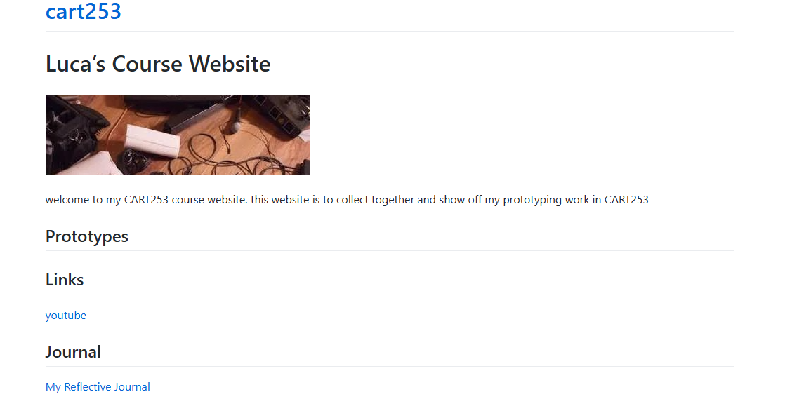
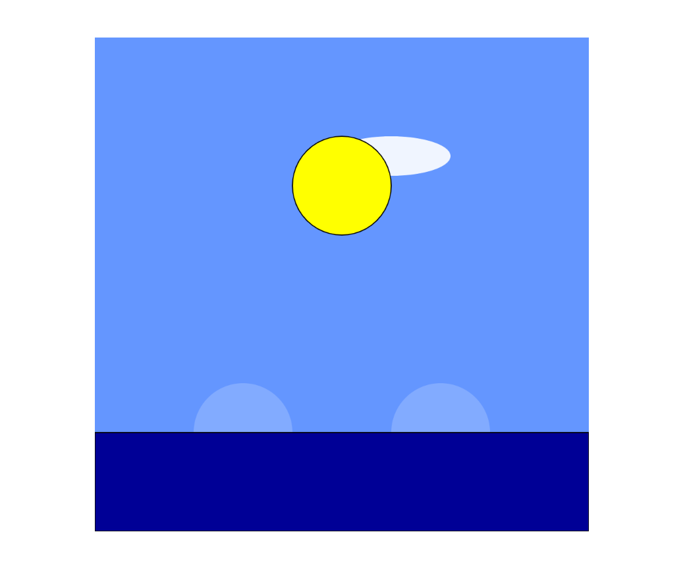
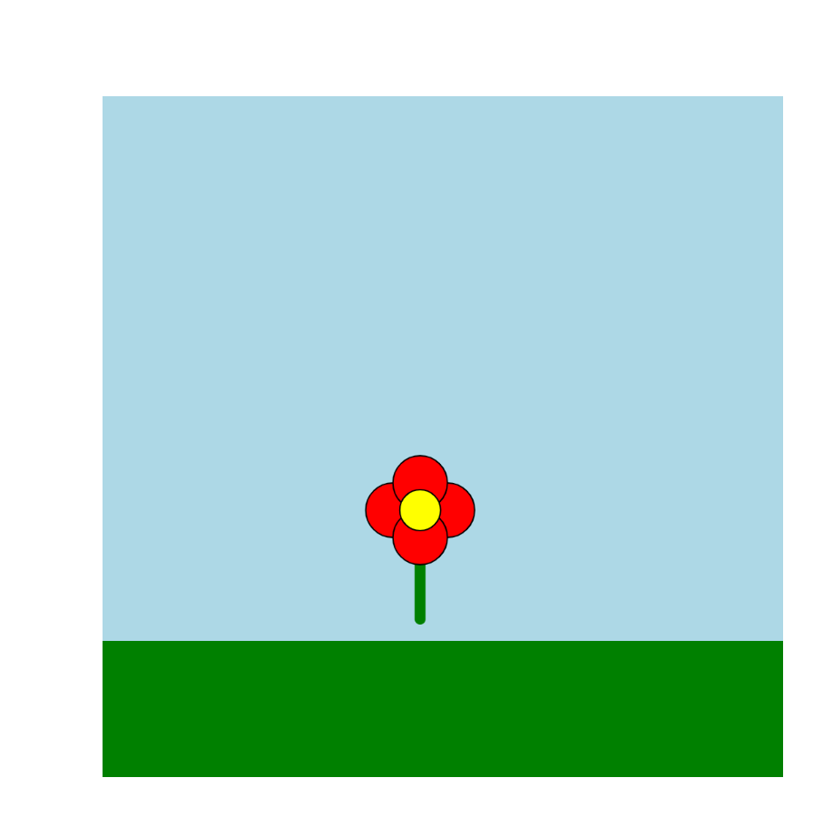

# Reflective Journal
## september 15 2026
I’ve learned a lot about Markdown and how to use it for my websites, especially for things like headings and other formatting. At first, I thought I would struggle with it and that it would be more complicated than it actually was. I was surprised by how simple it was once I started using it and understanding how everything worked. It was cool to see the workings of a website behind the scenes and understand how the different parts come together to create what you see on a website.
One thing I had a lot of trouble with was needing to commit my work to main for it to actually show up on the website. It was sometimes frustrating because I expected my changes to appear right away, but I learned that I had to make sure everything was committed properly before I could see the changes online.
Overall, I enjoyed learning about Markdown and working with websites in this way. I hope that what I made can make other people interested in coding and encourage them to try it for themselves. My aspirations for this are to become comfortable enough with Markdown and coding that I can do things like this easily and on a bigger scale. I want to be able to understand what I am doing without struggling as much and eventually create bigger and more complicated websites while still feeling confident about the process.

## september 22 2026
This assignment was actually very entertaining. I had a lot of fun trying to learn everything and figure it out. Once I got the hang of things it felt very rewarding. I learned how to make it so that colors chnage as time goes on. I also learned all the different ways you can choose a color for all the different possible shapes. This aasigment allowed me to learn where everything is located while using the variables. One Challenge i faced was trying to figure put everything in the uter wilds themed drawing. I had trouble with the space ship especially but also with making the sun go from orange to red. Overall this was a great experience and it really helped me to learn hands on how the coding works.

 
## september 29 2026
This assignment taught me alot about many many things. one of the first things i learned is  how to make certain variables change when another set of variables does. I leanred this by using map many times untill i understood and was able to use it withought needing guidance. I also figure out how to use when clicked. I leanred how to use whenclicked and then used it to reset the game i made for this project. i also used alot more commiting to main this time around. It was deffinitly one of my favprite things ive done so far. I think this project has really got the lesson and ways to accomplish what i want or need to do engrained in my brain.

## october 6 2026
This is one of the assignments I had the most trouble with, especially when it came to finding ideas for what I actually wanted to make. For some reason, I struggled a lot just trying to come up with ideas for the different prototypes. I would think of something and then realize it either wouldn’t work for the assignment or I just didn’t really know how I wanted to make it. I think this was probably the hardest part of the whole assignment for me because once I actually had an idea, making it was a lot easier.
In the end, I was able to figure it out and come up with prototypes that I was happy with. I also learned a lot while working on them. One of the main things I learned was how to create little games where the player can interact with objects and push things around. Before doing this assignment, I didn’t really know how to make something like that work properly, so it was interesting figuring it out and seeing everything actually work in the end.
I also learned more about adding interactive buttons and making them actually do something when the player presses them. Even though I struggled a lot at the beginning, I think the assignment ended up being pretty useful. It forced me to come up with ideas even when I was stuck and also taught me a few new things that I can probably use again in future projects. Overall, I think I learned more from struggling with this assignment than I would have if everything had been easy from the start.

## october 27 2026
This week, working with events completely changed how I think about my programs because they finally feel interactive and alive. Before this, my code just ran on its own loop, but now it actually responds to outside input like mouse clicks, keyboard presses, or even time passing. It was really cool to see how adding events can change the whole meaning of a project and make the user feel like they are directly influencing a living system.
For my first prototype, I focused on basic user input like mouse clicks and key presses. I combined events with conditionals so that hitting specific keys would instantly change variables like background colors and object sizes. It was awesome to see how a simple click could completely disrupt the flow of the program. My second prototype was a bit more experimental, exploring time-based events. I wanted to see what happens when the program makes the user wait, or when things happen automatically after a certain amount of time passes. This was honestly the hardest part to understand because tracking time in code can get confusing, but it was really cool to create a sense of anticipation. For the final prototype, I focused on making the program feel "demanding," almost like it had its own body or personality, by requiring the user to spam a key repeatedly just to keep an element on the screen from disappearing.
I hope someone playing these prototypes feels a sense of control but also a bit of frustration depending on how the events react to them. I definitely want to develop the time based mechanics further in future projects.

## october 27 2026
This week, learning how to use functions completely changed how I think about writing code. At first, they honestly seemed like an unnecessary extra step just wrapping perfectly fine code inside a new set of curly brackets for no reason. But as I built my three prototypes, I realized that functions aren't about adding flashy new visual features. Instead, they make managing a ton of elements way easier and keep your code from looking like a messy, copy-pasted wall of text.
For my first prototype, I focused on parameters. Before this, if I wanted multiple elements with the same behavior, I had to copy and paste blocks of variables over and over. By putting that behavior into a single reusable function with parameters for things like position or speed, I could spawn a whole bunch of matching elements with just a few quick lines.
My second prototype explored return values, which was definitely the hardest part of the week for me. It took me a minute to wrap my head around how data flows out of a function. I ended up using a function to calculate and return randomized data for my program elements. Once I got it to work, I realized how cool it is for making things dynamic.
For the final prototype, I practiced refactoring. I wrote a chaotic program the "usual way" first, and then replaced the repetitive code with clean function calls. It was really satisfying it felt like cleaning a super messy bedroom. What surprised me most was how much shorter and easier to read my main program became.
Looking back, the coolest thing is realizing how functions let you scale up a project without making it impossible to manage. I definitely want to develop this further to handle more complex movement or interactive setups in future projects.
